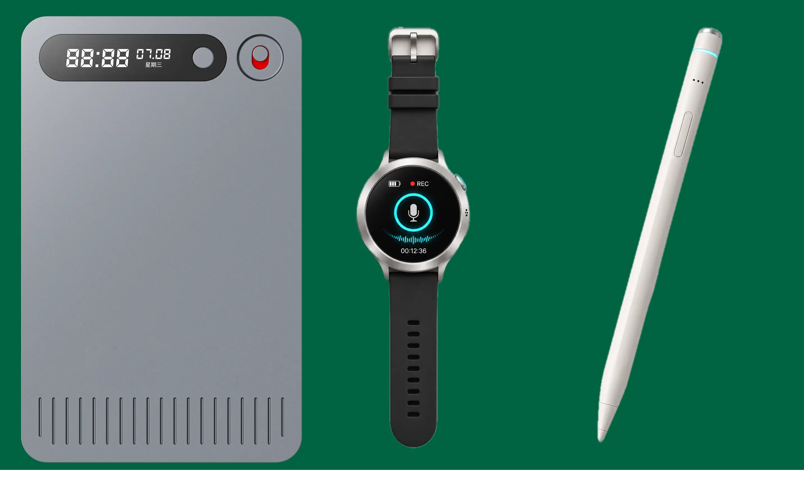

# JieLiSdkRecorder User Guide

[中文文档](docs/README.zh-CN.md) | [Android SDK](https://github.com/caitunai/JieLi-Recorder-Android-Sdk)

- Bluetooth scanning
- Device connection and disconnection
- Time synchronization
- Recording start, stop, and status query
- Realtime audio stream callback with PCM output
- Storage capacity query
- Recording file count query
- Recording file list retrieval
- Recording file deletion
- Recording file download as Ogg-wrapped Opus or unmodified source bytes
- Resumable raw-file download
- Key / touch behavior configuration
- Software-triggered key / touch event simulation
- OTA upgrade and cancellation
- Device binding, authentication, and unbinding (HuanGe only)

## 1. Important Xcode Setup

Before using any `JL****.xcframework` in your app, make sure the following Xcode integration steps are completed.

### 1.1 Add the Swift Package

Add the following package URL in Xcode and select the `JieLiSdkRecorder`
product:

```text
https://github.com/caitunai/JieLi-Recorder-iOS-Sdk.git
```

The distributed `JieLiSdkRecorder.xcframework` is a dynamic framework.
The package provides and embeds the required dynamic JieLi and JLAudioUnitKit frameworks.

### 1.2 Framework Embedding

Swift Package Manager configures the required dynamic frameworks for the
application target. Do not manually add duplicate copies of any framework
already provided by the package.

### 1.3 Configure `Other Linker Flags`

This SDK depends on Objective-C categories / extension-based members inside bundled libraries. Because of that, you must add the following linker flag in your app target:

- Open `Build Settings`
- Find `Other Linker Flags`
- Add `-ObjC`

If `-ObjC` is missing, category-based methods or properties from bundled Objective-C libraries may not be linked correctly at runtime.

## 2. Integration Requirements

- Swift 6.2 or later. The package manifest currently uses Swift tools 6.3.
- Import the SDK module in files that use it:

```swift
import JieLiSdkRecorder
```

- Declare Bluetooth permission in `Info.plist`:

```xml
<key>NSBluetoothAlwaysUsageDescription</key>
<string>The app needs Bluetooth to scan and connect JieLi devices.</string>
```

## 3. Notes Before Use

- `BLEManager.startScan()` clears the current discovered device list and starts a new scan.
- The SDK includes an internal auto-stop scan policy. If you need to keep scanning, call `continueScan()`.
- `downloadFile` converts the received raw Opus stream into an Ogg container; `downloadRawFile`
  writes the received source bytes without decoding or conversion.
- Only raw-file downloads support resuming. Opus-to-Ogg downloads must start at offset `0`.
- `onFileDownloadUpdate(_:event:)` is available only on iOS 16.0 and later.
- Business events are mainly delivered through `BLECallback`.
- The SDK supports two calling styles:
  - Recommended: pass a `BLEDevice` directly each time
  - Compatibility mode: select the current device first, then call the parameterless APIs
- `BLEDevice.source` identifies the owning BLE stack: `.jieLi`, `.pnote`, or `.huanGe`.
- HuanGe devices use the same public scan, connection, recording, storage, file, and OTA APIs.

## 4. Core Types

### 4.1 `BLEManager`

`BLEManager` is the main entry point of the SDK and is responsible for:

- Bluetooth scanning
- Connection management
- Business command dispatch
- File operations
- OTA control
- Event callback dispatching

### 4.2 `BLEDevice`

`BLEDevice` represents a discovered device. Common fields include:

- `id`: unique device identifier
- `name`: device name
- `mac`: device MAC address
- `batteryPower`: current battery percentage
- `charging`: whether the device is charging
- `isChargedFull`: whether the battery is fully charged
- `version`: firmware version code
- `versionName`: firmware version name
- `connectionStatus`: current connection status
- `isConnected`: whether the device is currently connected

### 4.3 `BLECallback`

Implement `BLECallback` to receive scan, connection, recording, file, OTA, and error callbacks. The protocol provides default empty implementations for all methods, so you only need to implement the callbacks your app actually uses.

Common callbacks include:

- `onDiscovery(_:)`
- `onScanStopped()`
- `onConnectionChange(_:status:)`
- `onBatteryChange(_:)`
- `onTimeSynced(_:success:)`
- `onFilesRetrieved(_:)`
- `onFileDeleteUpdate(_:event:)`
- `onFileDownloadUpdate(_:event:)`
- `onRecordStart(_:started:)`
- `onRecordStop(_:stopped:)`
- `onRecordStateUpdate(_:state:)`
- `onRealtimeAudioStarted()`
- `onRealtimeAudioReceived(audio:)`
- `onRealtimeAudioStopped()`
- `onStorageSizeUpdate(_:available:total:)`
- `onRecordFilesCountUpdate(_:fileCount:)`
- `onKeyTouchBehaviorUpdate(_:isSuccess:errorMessage:)`
- `onKeyTouchReceived(_:keyTouchBehavior:)`
- `onKeyTouchEmitted(_:isSuccess:)`
- `onOTAUpdate(_:event:)`
- `onUpgradeUnfinished(_:)`
- `onDeviceBindingStateChanged(_:state:)`
- `onError(_:errorCode:)`

## 5. Initialize `BLEManager`

It is recommended to create and retain a long-lived `BLEManager` instance in your business layer throughout the entire Bluetooth session lifecycle.

```swift
import JieLiSdkRecorder

final class RecorderService {
    let manager = BLEManager(
        configuration: .init()
    )
}
```

## 6. Register Callbacks

The SDK provides the following way to receive scan discovery events:

- Register a `BLECallback`

For complete business scenarios, it is recommended to standardize on `BLECallback`.

```swift
import JieLiSdkRecorder

final class RecorderCallbackProxy: BLECallback {
    var onDevice: ((BLEDevice) -> Void)?
    var onConnection: ((BLEDevice, ConnectionCode) -> Void)?

    func onDiscovery(_ device: BLEDevice) {
        onDevice?(device)
    }

    func onConnectionChange(_ device: BLEDevice, status: ConnectionCode) {
        onConnection?(device, status)
    }

    func onError(_ device: BLEDevice, errorCode: BLEErrorCode) {
        print("SDK error:", device.name, errorCode.getMessage())
    }
}

let manager = BLEManager()
let callback = RecorderCallbackProxy()
manager.addCallback(callback)
```

Remove the callback when it is no longer needed:

```swift
manager.removeCallback(callback)
```

## 7. Scan Devices

### 7.1 Start Scanning

```swift
manager.startScan()
```

When a device is discovered, the SDK returns it through:

```swift
func onDiscovery(_ device: BLEDevice)
```

Recommended app-layer handling:

- Clear the current device list before starting a new scan
- De-duplicate or update devices by `device.id`
- Display `name`, `mac`, `batteryPower`, `versionName`, and `connectionStatus` in the UI

### 7.2 Continue Scanning

If scanning was automatically stopped by the SDK, or manually stopped by the app and needs to continue:

```swift
manager.continueScan()
```

### 7.3 Stop Scanning

```swift
manager.stopScan()
```

When scanning ends, the SDK calls:

```swift
func onScanStopped()
```

## 8. Connect and Disconnect

### 8.1 Connect to a Device

It is recommended to pass a `BLEDevice` directly:

```swift
manager.connect(device) { status in
    print("Connection status:", status.getMessage())
}
```

Connection state changes are also returned through:

```swift
func onConnectionChange(_ device: BLEDevice, status: ConnectionCode)
```

Possible values for `ConnectionCode`:

- `.disconnected`
- `.connected`
- `.failed`
- `.connecting`
- `.systemError`

### 8.2 Disconnect a Device

```swift
manager.disconnect(device) { status in
    print("Disconnection status:", status.getMessage())
}
```

## 9. Current Device Mode

Most SDK capabilities provide two API styles:

- A version that accepts `BLEDevice` directly
- A version that operates on the "current device" without passing a device parameter

For example:

- `syncTime(_ device: BLEDevice, ...)`
- `syncTime(entity: JL_EntityM?, ...)`
- `startCustomRecord(_ device: BLEDevice)`
- `startCustomRecord()`

For app-layer integration, it is recommended to always use the `BLEDevice` overloads because they are the most direct and least error-prone.

If you do want to switch to "current device mode", a safer approach is:

```swift
manager.selectConnectedDevice(at: 0)
manager.startCustomRecord()
manager.queryRecordState()
```

This mode is suitable for scenarios such as:

- The current page operates on only one connected device
- The order of the connected device list is already known
- You want to make multiple subsequent calls through the parameterless APIs

Related helper APIs:

- `selectConnectedDevice(at:)`
- `clearCurrentDevice()`
- `currentBLEUUID`
- `currentEntity`
- `currentCommandManager`

## 10. Time Synchronization

Use the current system time to synchronize the device:

```swift
manager.syncTime(device) { success in
    print("Time sync result:", success)
}
```

You can also pass a specific time:

```swift
manager.syncTime(device, date: customDate) { success in
    print(success)
}
```

Callback:

```swift
func onTimeSynced(_ device: BLEDevice, success: Bool)
```

### Query Battery State

Use a JieLiSdkRecorder release that exposes this new API. Connect the device first; HuanGe devices should complete `bindOrVerifyDevice(_:using:)` before ordinary control queries.

```swift
public func queryBattery(_ device: BLEDevice) async throws -> BLEBatteryState
```

```swift
do {
    switch try await manager.queryBattery(device) {
    case .percentage(let value):
        print("Battery: \(value)%")
    case .charging:
        print("Charging; this response does not include a percentage")
    }
} catch let error as BLEBatteryQueryError {
    print("Battery query failed:", error.localizedDescription)
}
```

| Device source | Explicit query |
| --- | --- |
| `.huanGe` (including PNote products using HuanGe) | Supported through `getBatteryState()` |
| Native `.pnote` | Supported through `getCBC()`; a pending request times out after 10 seconds |
| `.jieLi` | Currently unsupported; throws `.unsupportedDeviceSource(.jieLi)` |

The result is a device response, not the cached `device.batteryPower` value. `BLEBatteryState.percentage(UInt8)` reports 0–100; `.charging` has no associated percentage. Do not treat charging as 100% or display a cached percentage as a new measurement. Existing `onBatteryChange(_:)` callbacks continue to report battery updates and update discovered-device snapshots. Callbacks and the async result may arrive at different times; dispatch UI updates to `MainActor`.

Errors are thrown as `BLEBatteryQueryError` and also delivered to `onError(_:errorCode:)`:

- `.unsupportedDeviceSource(source)`: unsupported stack; callback `.batteryQueryUnsupported` (1016).
- `.notConnected`: no current connection to the requested device; a stale connected snapshot does not authorize a query.
- `.disconnected`: connection lost before the query completed.
- `.requestFailed(message)`: timeout, invalid response, or another request failure. Native PNote also rejects a second battery query while one is pending.

The last three errors use callback `.queryBatteryFailed` (1017), with details. Failures do not return a fabricated zero percentage. The Demo provides a **Query Battery** button and shows percentage, charging-only state, or the failure message. A JieLi query demonstrates the unsupported-source error.

## 11. Recording Features

### 11.1 Start Recording

```swift
manager.startCustomRecord(device)
```

Callback:

```swift
func onRecordStart(_ device: BLEDevice, started: Bool)
```

### 11.2 Stop Recording

```swift
manager.stopCustomRecord(device)
```

Callback:

```swift
func onRecordStop(_ device: BLEDevice, stopped: Bool)
```

### 11.3 Query Recording Status

```swift
manager.queryRecordState(device)
```

Callback:

```swift
func onRecordStateUpdate(_ device: BLEDevice, state: BLERecordState)
```

`BLERecordState` includes:

- `.idle`
- `.recording`

### 11.4 Realtime Audio Stream

The device can also report a realtime audio stream while recording. The SDK converts the incoming non-standard Opus stream into PCM data and returns it through `BLECallback`.

Realtime audio callbacks:

```swift
/// Called when the SDK starts converting the realtime non-std Opus stream into an PCM stream.
func onRealtimeAudioStarted()

/// Called when one chunk of realtime audio is available.
/// The returned data is PCM audio generated from the incoming non std-Opus stream.
/// PCM sampleRate: 16Khz, int16, Mono
func onRealtimeAudioReceived(audio: Data)

/// Called when the realtime audio stream stops.
func onRealtimeAudioStopped()
```

PCM format details:

- Sample rate: `16 kHz`
- Sample format: `Int16`
- Channel count: `Mono`

Recommended app-layer handling:

- Start or reset your local PCM buffer in `onRealtimeAudioStarted()`
- Append each incoming PCM chunk in `onRealtimeAudioReceived(audio:)`
- Stop playback, finalize the local file, or trigger sharing in `onRealtimeAudioStopped()`
- If you need file playback outside the app, save the stream using a PCM-compatible container such as `.wav`

### 11.5 Query Storage Capacity

Recommended device-based API:

```swift
manager.queryStorageSize(device)
```

When the app has already selected a current device, the compatibility API is
also available:

```swift
manager.queryStorageSize()
```

Callback:

```swift
func onStorageSizeUpdate(_ device: BLEDevice, available: UInt64, total: UInt64)
```

Where:

- `available`: remaining capacity in bytes, represented as `UInt64`
- `total`: total capacity in bytes, represented as `UInt64`

Storage values use `UInt64` because device capacities expressed in bytes may
exceed the range of a 32-bit integer. Convert the values only when required by
the app's presentation layer.

### 11.6 Query Recording File Count

```swift
manager.queryRecordFiles(device)
```

Callback:

```swift
func onRecordFilesCountUpdate(_ device: BLEDevice, fileCount: Int)
```

## 12. Retrieve File List

The current SDK retrieves recording files from the device recording directory `OPUS_REC`.

### 12.1 Set the Maximum Retrieval Count

If needed, you can set the maximum number of files before retrieval:

```swift
manager.setMaxRetrieveFilesCount(100)
```

The SDK uses internal pagination. Each "load more" call retrieves the next page.

### 12.2 Refresh the File List from the Beginning

Use this when entering the file page for the first time or when performing pull-to-refresh:

```swift
manager.retrieveFilesFromStart(device)
```

### 12.3 Load More Files

```swift
manager.retrieveFiles(device)
```

### 12.4 File List Callback

```swift
func onFilesRetrieved(_ files: [BLEFile])
```

For `.huanGe` devices, `onFilesRetrieved(_:)` returns files in descending order of the creation time encoded in their names. Supported names are `yyyyMMdd-HHmmss.opus`, `callyyyyMMdd-HHmmss.opus`, and `noteyyyyMMdd-HHmmss.opus`; `.mp3` is also recognized, and prefixes/extensions are case-insensitive. For example, `note20261110-120000.opus` appears before `20261110-111012.opus` regardless of its prefix.

Calendar dates and clock values are validated. Files with unrecognized names or invalid dates are retained at the end in device order; equal timestamps also preserve device order. Sorting uses the wall-clock time written in the name without inferring a timezone. The Demo displays the SDK-provided order.

Current primary field in `BLEFile`:

- `name`
- `size`
- `timestamp`

Recommended UI-layer handling:

- Reset the list when calling `retrieveFilesFromStart`
- Replace the local file list after the callback returns
- Call `retrieveFiles` to continue pagination
- Use `BLEFile.name` as the unique key for file selection state

## 13. Delete Files

Delete one or more recording files by name:

```swift
manager.deleteFiles(device, filenames: ["REC0001.OPUS", "REC0002.OPUS"])
```

Callback:

```swift
func onFileDeleteUpdate(_ device: BLEDevice, event: BLEFileDeleteEvent)
```

Possible values for `BLEFileDeleteEvent.Event`:

- `.success`
- `.error`
- `.finish`

Recommended handling:

- On `.success`, remove the file from both the selected list and the local file list
- On `.error`, display the failure reason for that specific file
- On `.finish`, end the deleting UI state and summarize the success and failure counts

## 14. Download Files

The SDK provides two separate download modes:

- `downloadFile`: receives the raw Opus stream and writes an Ogg-wrapped Opus file. This mode does
  not support resuming.
- `downloadRawFile`: writes the received source bytes directly to disk without Opus decoding or Ogg
  conversion. This mode supports resuming from an absolute byte offset.

The same public APIs work with JieLi, PNote, and HuanGe devices.

### 14.1 Download Opus and Convert It to Ogg

It is recommended that the app layer explicitly provides an output URL with an `.ogg` extension:

```swift
let outputURL = FileManager.default
    .urls(for: .documentDirectory, in: .userDomainMask)[0]
    .appendingPathComponent("record_001.ogg")

manager.downloadFile(
    device,
    filename: "REC0001.OPUS",
    outputURL: outputURL
)
```

Notes:

- The final saved content is Ogg-wrapped Opus, so `.ogg` is the recommended extension.
- Opus-to-Ogg conversion cannot be resumed. Passing a nonzero `resumeFromOffset` reports an error.
- In the Demo, the output file is shared directly after a successful download

To use the default cache path:

```swift
manager.downloadFile(device, filename: "REC0001.OPUS")
```

Default cache directory:

- `Caches/jieli_sdk_download/<filename>`

#### HuanGe Opus-to-Ogg Downloads

With HuanGe SDK 1.0.7 or later, `downloadFile` automatically uses `importFileAllowingPacketLoss(_:resumeFromOffset:)` with offset zero for `.huanGe` devices, regardless of the `integrityMode` argument. No application API changes are required. This mode starts at zero and accepts a byte shortfall only after the device reports successful completion. The wrapper drains the actual `completion.byteCount` before closing the Ogg writer, rather than waiting for the original file size. A shortfall alone no longer triggers a download error; SDK logs record expected, received, and missing byte counts.

Chunk offsets are positions in the compact received output, so the wrapper still rejects gaps in that local stream. This mode does not bypass CRC, pad missing bytes, repair Opus frames, or retransmit data. Audio may be incomplete or fail conversion. Empty audio, excess data, device rejection, cancellation, disconnection, timeout, local stream/writing errors, and conversion errors retain their existing handling. `.finish` means the device completed the tolerant transfer and the Ogg writer closed successfully, not that all source audio arrived. Progress may end below 100% before `.finish` reports 100%; `bytesCount` reflects received Opus bytes, not the expected file size or Ogg output size.

`downloadRawFile` and raw-file resume default to strict `importFile(_:resumeFromOffset:)`; HuanGe callers may explicitly opt into tolerant raw imports as described below. The Demo labels HuanGe Ogg downloads as packet-loss-tolerant and disables the generic integrity selector for that device source. Validate lossy audio playback on the target hardware before relying on the output.

### 14.2 Download the Original File Bytes

#### Optional HuanGe Packet-Loss-Tolerant Resume (SDK 1.0.7)

New `downloadRawFile` overloads accept an explicit `integrityMode`; existing signatures are preserved and continue to use `.strict`. To allow a byte shortfall on HuanGe while resuming a verified original Opus prefix:

```swift
manager.downloadRawFile(
    device,
    filename: "REC0001.OPUS",
    outputURL: rawOutputURL,
    integrityMode: .allowPacketLossForOpusStream,
    resumeFromOffset: verifiedDeviceOffset
)
```

Here `rawOutputURL` is the local raw-file URL and `verifiedDeviceOffset` is a `UInt32` device-file byte offset independently matched to its saved prefix. This mode is supported only for `.huanGe`; other sources report a download error. The existing file must contain at least the requested prefix; it is truncated to that offset and the new bytes are appended. Offset zero replaces the destination.

The first new chunk begins at the requested offset. `completion.byteCount` and download `bytesCount` include the saved prefix plus this request's received bytes. The wrapper waits for that accumulated count after device success, even if it is below the original size. If the device accepts completion without any new bytes, a verified nonempty prefix may remain as the result. Timeout, disconnection, rejection, writing errors and excess data still fail.

**Do not derive a device offset from a previously lossy file's length.** The SDK does not know where bytes were lost and does not validate the prefix. The Demo requires an explicit offset and confirmation for a nonzero tolerant resume, saves tolerant output separately with a `.lossy` suffix, and continues to use file length automatically only for its default strict raw-download path. Opus-to-Ogg downloads still start at zero; existing Ogg files cannot be appended using an Opus byte offset.


Use `downloadRawFile` when the file must be saved exactly as it is received from the device:

```swift
let rawOutputURL = FileManager.default
    .urls(for: .documentDirectory, in: .userDomainMask)[0]
    .appendingPathComponent("REC0001.OPUS")

manager.downloadRawFile(
    device,
    filename: "REC0001.OPUS",
    outputURL: rawOutputURL
)
```

This mode does not decode Opus and does not create an Ogg container. It can also be used for
non-audio files.

### 14.3 Resume a Raw-File Download

`resumeFromOffset` is an absolute source-file byte offset. The existing destination file must contain
at least that many bytes. A common approach is to resume from the current local file size:

```swift
let existingBytes: UInt64
if FileManager.default.fileExists(atPath: rawOutputURL.path) {
    let attributes = try FileManager.default.attributesOfItem(atPath: rawOutputURL.path)
    existingBytes = (attributes[.size] as? NSNumber)?.uint64Value ?? 0
} else {
    existingBytes = 0
}

guard existingBytes <= UInt64(UInt32.max) else {
    throw CocoaError(.fileReadTooLarge)
}
let resumeOffset = UInt32(existingBytes)

manager.downloadRawFile(
    device,
    filename: "REC0001.OPUS",
    outputURL: rawOutputURL,
    resumeFromOffset: resumeOffset
)
```

Resume rules:

- Pass `0` to replace the existing destination file and download from the beginning.
- The SDK preserves exactly the prefix before `resumeFromOffset` and removes any stale bytes after it.
- An offset beyond the existing local file or remote source file produces an `.error` event.
- If the local file is already complete, the SDK finishes locally without starting another BLE file
  transfer.
- Raw-file cancellation and transport errors keep the partial file. Use its size as the offset for the
  next `downloadRawFile` call.

The overload without `outputURL` writes to `Caches/jieli_sdk_download/<filename>`:

```swift
manager.downloadRawFile(
    device,
    filename: "REC0001.OPUS",
    resumeFromOffset: resumeOffset
)
```

When resuming with the default-path overload, calculate `resumeOffset` from the file in that cache
directory rather than from `rawOutputURL`.

After selecting a current device, the compatibility overloads are also available:

```swift
manager.downloadRawFile("REC0001.OPUS", outputURL: rawOutputURL, resumeFromOffset: resumeOffset)
manager.downloadRawFile("REC0001.OPUS", resumeFromOffset: resumeOffset)
```

### 14.4 Download Callback

```swift
@available(iOS 16.0, *)
func onFileDownloadUpdate(_ device: BLEDevice, event: BLEFileDownloadEvent)
```

Possible values for `BLEFileDownloadEvent.Event`:

- `.begin`
- `.progress`
- `.finish`
- `.cancel`
- `.error`

Common fields in `BLEFileDownloadEvent`:

- `file`: file name on the device
- `progress`: download progress percentage
- `packages`: number of received data packets
- `duration`: elapsed time
- `bytesCount`: total source bytes written, including the preserved prefix when resuming
- `path`: final, in-progress, or resumable partial output file path
- `errorCode`
- `errorMsg`

Recommended handling:

- `.begin`: reset the download progress and statistics
- `.progress`: update the progress bar, byte count, packet count, and duration
- `.finish`: use `event.path` for playback, sharing, or export
- `.cancel`: stop the downloading UI; raw mode keeps the partial file at `event.path`
- `.error`: prioritize displaying `event.errorMsg`

### 14.5 Cancel a Download

Cancel the active download for any supported device type with:

```swift
manager.cancelDownloadFile(device)
```

For raw-file mode, cancellation closes and retains the partial output so it can be resumed later. For
Opus-to-Ogg mode, an incomplete converted output is removed.

## 15. Key / Touch Configuration

The SDK supports configuring key / touch behavior on the device and also supports software-triggering the corresponding event.

### 15.1 Build the Behavior Model

```swift
let behavior = BLEKeyTouchBehavior(
    key: "key1",
    event: BLEKeyTouchBehavior.click,
    behavior: BLEKeyTouchBehavior.play
)
```

Supported key / touch values:

- `key0`
- `key1`
- `key2`
- `touch0`
- `touch1`
- `touch2`

Supported event values:

- `click`
- `db_click`
- `long_press`
- `swipe_left`
- `swipe_right`
- `swipe_up`
- `swipe_down`

Supported behavior values include:

- `no_action`
- `open`
- `close`
- `previous`
- `next`
- `play`
- `pause`
- `answer_call`
- `hang_up_call`
- `call_back`
- `volume_up`
- `volume_down`
- `take_photo`
- `record`
- `stop_record`
- `anc_change_list`

### 15.2 Set Key / Touch Behavior

```swift
manager.setKeyTouchBehaviorEvent(device, keyTouchBehavior: behavior)
```

Callback:

```swift
func onKeyTouchBehaviorUpdate(_ device: BLEDevice, isSuccess: Bool, errorMessage: String)
```

### 15.3 Query Key / Touch Behavior

Use `queryKeyTouchBehavior(_:)` to read the current key / touch behavior configuration from a connected device.

```swift
manager.queryKeyTouchBehavior(device)
```

If you have already selected the current device, you can also use:

```swift
manager.queryKeyTouchBehavior()
```

The query result is delivered through `BLECallback`. One device may return multiple behavior records, so this callback may be invoked more than once for a single query.

```swift
func onKeyTouchReceived(_ device: BLEDevice, keyTouchBehavior: BLEKeyTouchBehavior) {
    let key = BLEKeyTouchBehavior.displayNameForKey(keyTouchBehavior.key)
    let event = BLEKeyTouchBehavior.displayNameForEvent(keyTouchBehavior.event)
    let behavior = BLEKeyTouchBehavior.displayNameForBehavior(keyTouchBehavior.behavior)
    print("Current key/touch behavior:", key, event, behavior)
}
```

### 15.4 Simulate a Key / Touch Trigger

```swift
manager.emitKeyTouchBehaviorEvent(device, keyTouchBehavior: behavior)
```

Callback:

```swift
func onKeyTouchEmitted(_ device: BLEDevice, isSuccess: Bool)
```

### 15.5 Display Text Helper Methods

If you need Chinese display names in the UI, you can directly use:

- `BLEKeyTouchBehavior.displayNameForKey(_:)`
- `BLEKeyTouchBehavior.displayNameForEvent(_:)`
- `BLEKeyTouchBehavior.displayNameForBehavior(_:)`

## 16. OTA Upgrade

The OTA API requires the app layer to provide the firmware data.

### 16.1 Read the Firmware File

```swift
let firmwareURL: URL = ...
let firmwareData = try Data(contentsOf: firmwareURL)
```

### 16.2 Start OTA

```swift
manager.startOTA(device, firmwareData: firmwareData)
```

### 16.4 OTA Callbacks

```swift
func onOTAUpdate(_ device: BLEDevice, event: BLEOTAEvent)
func onUpgradeUnfinished(_ device: BLEDevice)
```

Possible values for `BLEOTAEvent.Event`:

- `.start`
- `.preparing`
- `.prepared`
- `.progress`
- `.reconnect`
- `.reboot`
- `.finish`
- `.cancel`
- `.error`

Common fields in `BLEOTAEvent`:

- `progress`
- `resultCode`
- `errorCode`
- `errorMsg`

It is recommended that the OTA UI covers at least these states:

- Upgrade file selected
- File verification in progress
- Upgrade in progress
- Device reconnecting
- Device rebooting
- Upgrade successful
- Upgrade canceled
- Upgrade failed

If `onUpgradeUnfinished(_:)` is received, it means the device reports an unfinished upgrade task. The app layer can notify the user and continue the OTA flow again if needed.

## 17. Device Binding, Authentication, and Unbinding (HuanGe Only)

The SDK supports device binding and identity verification for HuanGe devices. This feature allows you to bind a device with a 16-byte key and later verify the device's identity using the same key.

**Important**: These APIs support `BLEDeviceSource.huanGe`, including PNote products connected through the HuanGe stack. Devices using `.jieLi` or the native `.pnote` stack are not supported and throw `BLEDeviceBindingError.unsupportedDeviceSource`. Support is determined by `device.source`, not the advertised device name.

After each HuanGe connection becomes ready, call `bindOrVerifyDevice(_:using:)` with the stored key before issuing ordinary control requests. Automatic battery and firmware queries run after binding or verification succeeds, so they do not precede authentication in the command queue.

If verification fails after reopening the app, distinguish `.notConnected` (no current connection) from `.disconnected` (connection lost during the operation) and `.bindingVerificationFailed` (authentication rejected). A connection error alone does not prove that the key is wrong. The Demo displays the device ID, a SHA-256 key fingerprint, and elapsed failure time; compare the ID and fingerprint before and after reopening without sharing the raw key. If the device is already bound but the local key is missing, the Demo refuses to generate a replacement. Invalid-length key files are preserved and reported as errors. The Demo still uses its original cache path for compatibility; production apps should use Keychain for durable secure storage.

### 17.1 Generate a Binding Key

The binding key must be exactly 16 bytes. Use `SecRandomCopyBytes` to generate a secure random key:

```swift
import Security

func generateBindingKey() -> Data? {
    var key = Data(count: 16)
    let result = key.withUnsafeMutableBytes { bytes in
        SecRandomCopyBytes(kSecRandomDefault, 16, bytes.bindMemory(to: UInt8.self).baseAddress!)
    }
    return result == errSecSuccess ? key : nil
}
```

### 17.2 Query Device Binding State

Check whether a device is already bound:

```swift
let state = try await manager.getDeviceBindingState(device)
// Returns: .unbound or .bound
```

Possible values for `BLEDeviceBindingState`:

- `.unbound`: Device is not bound
- `.bound`: Device is already bound

Callback:

```swift
func onDeviceBindingStateChanged(_ device: BLEDevice, state: BLEDeviceBindingState)
```

### 17.3 Bind or Verify Device

Bind a device for the first time, or verify an already-bound device:

```swift
let result = try await manager.bindOrVerifyDevice(device, using: key)
// Returns: .bound (first-time bind) or .verified (identity verified)
```

Possible values for `BLEDeviceBindingResult`:

- `.bound`: Device was successfully bound for the first time
- `.verified`: Device identity was successfully verified

### 17.4 Verify Device Binding Only

Verify an already-bound device without attempting to bind:

```swift
try await manager.verifyDeviceBinding(device, using: key)
```

This will throw an error if the device is not bound or if the provided key is incorrect.

### 17.5 Key Storage Best Practices

The binding key must be securely stored by your app. Recommended storage locations:

- **Keychain**: Most secure option for production apps
- **App sandbox directory**: Suitable for development/Demo (e.g., `NSTemporaryDirectory` or `FileManager.default.urls(for: .cachesDirectory, in: .userDomainMask)`)

**Important**: Never hardcode binding keys or store them in UserDefaults. If the key is lost, you will not be able to verify the device identity.

### 17.6 Error Handling

Device binding errors are returned as `BLEDeviceBindingError`:

- `.unsupportedDeviceSource(BLEDeviceSource)`: Unsupported device source (`.jieLi` or native `.pnote`)
- `.invalidBindingKeyLength`: Provided key is not exactly 16 bytes
- `.deviceNotBound`: Attempted to verify a device that has not been bound
- `.bindingKeyRejected`: Device rejected the binding key
- `.bindingVerificationFailed`: Device binding verification failed
- `.deviceUnbindingFailed`: Device explicitly rejected unbinding
- `.notConnected`: No current connection to the requested device
- `.disconnected`: The connection was lost before the binding operation completed
- `.systemError(String)`: Other system-level errors

### 17.7 Complete Binding Flow Example

```swift
import Foundation
import JieLiSdkRecorder
import Security

final class DeviceBindingManager {
    private let manager = BLEManager()
    private var bindingKeys: [String: Data] = [:]

    /// Generate a secure 16-byte binding key
    func generateBindingKey() -> Data? {
        var key = Data(count: 16)
        let result = key.withUnsafeMutableBytes { bytes in
            SecRandomCopyBytes(kSecRandomDefault, 16, bytes.bindMemory(to: UInt8.self).baseAddress!)
        }
        return result == errSecSuccess ? key : nil
    }

    /// Check if device is bound
    func checkBindingState(for device: BLEDevice) async throws -> BLEDeviceBindingState {
        return try await manager.getDeviceBindingState(device)
    }

    /// Bind or verify device
    func bindOrVerify(_ device: BLEDevice) async throws -> BLEDeviceBindingResult {
        // Retrieve or generate binding key
        let key: Data
        if let existingKey = bindingKeys[device.id] {
            key = existingKey
        } else {
            guard let newKey = generateBindingKey() else {
                throw BLEDeviceBindingError.systemError("Failed to generate binding key")
            }
            bindingKeys[device.id] = newKey
            key = newKey
        }

        let result = try await manager.bindOrVerifyDevice(device, using: key)

        // Store key persistently (e.g., Keychain) after successful bind
        if result == .bound {
            saveBindingKey(key, for: device.id)
        }

        return result
    }

    /// Verify device with existing key
    func verifyDevice(_ device: BLEDevice) async throws {
        guard let key = bindingKeys[device.id] else {
            throw BLEDeviceBindingError.systemError("No binding key found for device")
        }
        try await manager.verifyDeviceBinding(device, using: key)
    }

    private func saveBindingKey(_ key: Data, for deviceId: String) {
        // Implement Keychain storage in production
        // This is a simplified example
    }
}
```

### 17.8 Unbind a BLE Peripheral

**Availability**: This is a newly added API pending a JieLiSdkRecorder binary release. Use a release that exposes `unbindDevice(_:)` and integrates HuanGe SDK 1.0.4 or later; updating the documentation does not add this method to an older binary. The minimum JieLiSdkRecorder release version will be specified when published. Device firmware must support HuanGe unbinding commands 20/21.

```swift
public func unbindDevice(_ device: BLEDevice) async throws
```

- **Parameter**: The currently connected `BLEDevice` with `source == .huanGe`, including PNote products connected through this stack. A stale connected-device snapshot is not a substitute for a live connection to that device.
- **Return value**: `Void`, only after the peripheral acknowledges successful unbinding. No key, NONCE, HMAC, or raw packet is required from the application.
- **Errors**: Throws `BLEDeviceBindingError` and also reports the error through `onError(_:errorCode:)`.

After the connection is ready and the user confirms the operation, call from an asynchronous context:

```swift
do {
    try await manager.unbindDevice(device)
    print("Device unbound successfully")
    // Only now apply your application's policy for retaining or deleting its stored key.
} catch BLEDeviceBindingError.unsupportedDeviceSource(let source) {
    print("Unbinding is not supported for:", source.rawValue)
} catch BLEDeviceBindingError.deviceUnbindingFailed {
    print("Device rejected unbinding. Keep the stored key.")
} catch BLEDeviceBindingError.notConnected {
    print("Device is not currently connected. Keep the key.")
} catch BLEDeviceBindingError.disconnected {
    print("Connection was lost before confirmation. Keep the key.")
} catch {
    print("Unbinding was not confirmed:", error.localizedDescription)
    // Keep the key. Query binding state again once the connection is ready.
}
```

Success also produces the existing `BLECallback` notification:

```swift
func onDeviceBindingStateChanged(_ device: BLEDevice, state: BLEDeviceBindingState) {
    if state == .unbound {
        print("Device is now unbound:", device.name)
    }
}
```

Dispatch UI updates to `MainActor`. Both the async result and the state callback can report the same successful operation; handle them without repeating business side effects.

| Outcome | Thrown error | `onError` code |
| --- | --- | --- |
| `.jieLi` or native `.pnote` source | `.unsupportedDeviceSource(source)` | `.deviceBindingUnsupported` (1010) |
| Device rejects the request | `.deviceUnbindingFailed` | `.deviceUnbindingFailed` (1015) |
| No current connection to the requested device | `.notConnected` | `.systemError` (1), with details |
| Disconnection before confirmation | `.disconnected` | `.systemError` (1), with details |
| Timeout, invalid response, or another underlying error | `.systemError(message)` | `.systemError` (1), with details |

Sending the request does not confirm success. On failure or an unknown outcome, keep the stored key and reconcile with `getDeviceBindingState(_:)` when the connection is ready. The call does not automatically authenticate, rebind, disconnect, or delete application-owned keys. After confirmed success, the application decides whether to retain or remove its key; use `bindOrVerifyDevice(_:using:)` explicitly to bind again.

The Demo's device-binding section provides an unbind button with confirmation, disables repeated requests while unbinding, and retains its cached test key for rebinding. The control is enabled only for connected `.huanGe` devices. Validate success, rejection, timeout/disconnection, and subsequent rebinding on the target hardware.

## 18. Error Handling

General business errors are returned through:

```swift
func onError(_ device: BLEDevice, errorCode: BLEErrorCode)
```

Common error constants:

- `BLEErrorCode.success`
- `BLEErrorCode.systemError`
- `BLEErrorCode.recordStartError`
- `BLEErrorCode.recordStopError`
- `BLEErrorCode.queryRecordStateError`
- `BLEErrorCode.queryStorageSizeFailed`
- `BLEErrorCode.countRecorderFilesFailed`
- `BLEErrorCode.emitSoftDeviceEventFailed`
- `BLEErrorCode.opusToOggFailed`
- `BLEErrorCode.keyTouchBehaviorUpdateFailed`
- `BLEErrorCode.fileDownloadFailed`
- `BLEErrorCode.deviceBindingUnsupported`
- `BLEErrorCode.invalidBindingKeyLength`
- `BLEErrorCode.deviceNotBound`
- `BLEErrorCode.bindingKeyRejected`
- `BLEErrorCode.bindingVerificationFailed`
- `BLEErrorCode.deviceUnbindingFailed` (1015)

Common methods:

- `errorCode.getCode()`
- `errorCode.getMessage()`
- `BLEErrorCode.getByCode(_:)`

## 19. Recommended Integration Flow

A complete business flow usually looks like this:

1. Create `BLEManager`
2. Register `BLECallback`
3. Call `startScan()`
4. Receive devices in `onDiscovery(_:)`
5. Let the user choose a target `BLEDevice`
6. Call `connect(_:)`
7. Wait until `onConnectionChange(_:status:)` becomes `.connected`
8. Execute business capabilities such as time sync, recording control, file operations, and OTA
9. Call `disconnect(_:)` when done

## 20. Minimal Integration Example

```swift
import Foundation
import JieLiSdkRecorder

final class DemoRecorderService: BLECallback {
    private let manager = BLEManager()
    private(set) var devices: [BLEDevice] = []

    init() {
        manager.addCallback(self)
    }

    func startScan() {
        devices.removeAll()
        manager.startScan()
    }

    func connectFirstDevice() {
        guard let device = devices.first else { return }
        manager.connect(device)
    }

    func syncTime(for device: BLEDevice) {
        manager.syncTime(device)
    }

    func refreshFiles(for device: BLEDevice) {
        manager.retrieveFilesFromStart(device)
    }

    func startRecord(for device: BLEDevice) {
        manager.startCustomRecord(device)
    }

    func stopRecord(for device: BLEDevice) {
        manager.stopCustomRecord(device)
    }

    func onRealtimeAudioStarted() {
        print("Realtime audio started")
    }

    func onRealtimeAudioReceived(audio: Data) {
        print("Realtime PCM bytes:", audio.count)
    }

    func onRealtimeAudioStopped() {
        print("Realtime audio stopped")
    }

    func onDiscovery(_ device: BLEDevice) {
        if let index = devices.firstIndex(where: { $0.id == device.id }) {
            devices[index] = device
        } else {
            devices.append(device)
        }
    }

    func onConnectionChange(_ device: BLEDevice, status: ConnectionCode) {
        print("Connection status:", device.name, status.getMessage())
    }

    func onFilesRetrieved(_ files: [BLEFile]) {
        print("File list:", files.map(\.name))
    }

    func onError(_ device: BLEDevice, errorCode: BLEErrorCode) {
        print("Error:", device.name, errorCode.getMessage())
    }
}
```

## 21. SDK Capabilities Already Covered

The SDK currently demonstrates the following capabilities:

- BLE scanning
- Device connection and disconnection
- Time synchronization
- Custom recording start and stop
- Recording status query
- Realtime audio PCM callback
- Storage capacity query
- Recording file count query
- File list refresh
- File pagination loading
- File deletion
- File download and sharing
- Key / touch behavior configuration
- Software-triggered key / touch events
- OTA file selection
- OTA start
- OTA cancel
- Device binding state query (HuanGe only)
- Device binding/verification (HuanGe only)
- Device unbinding with confirmation and retained test keys (HuanGe only)
